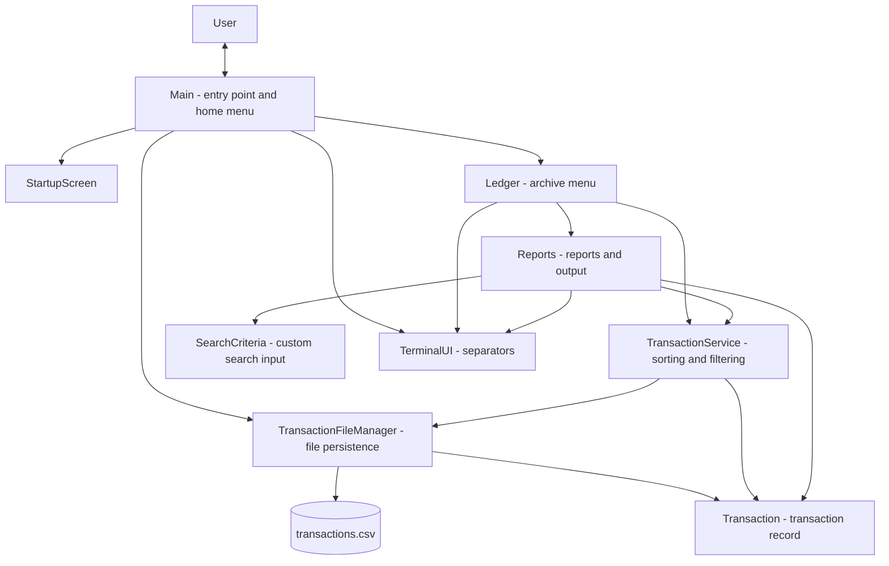
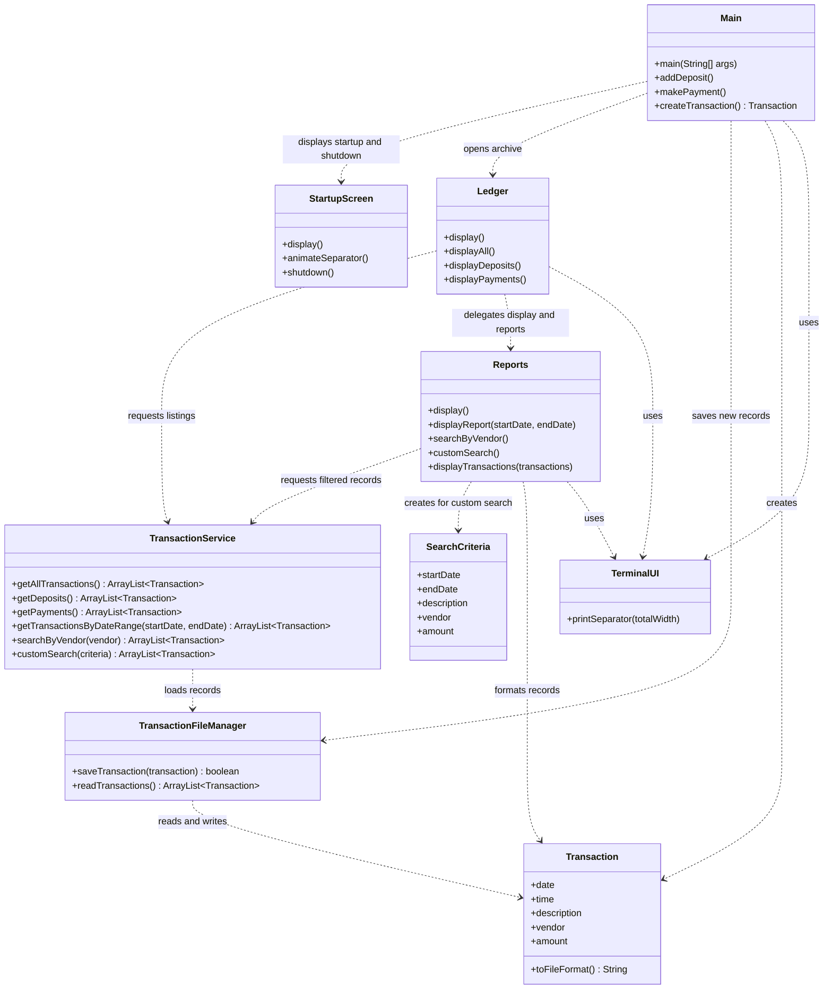
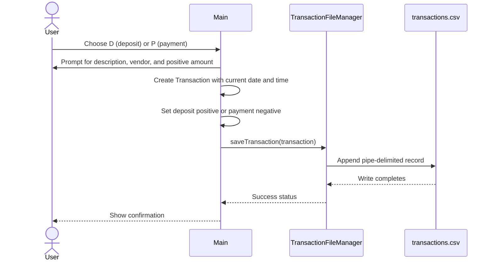
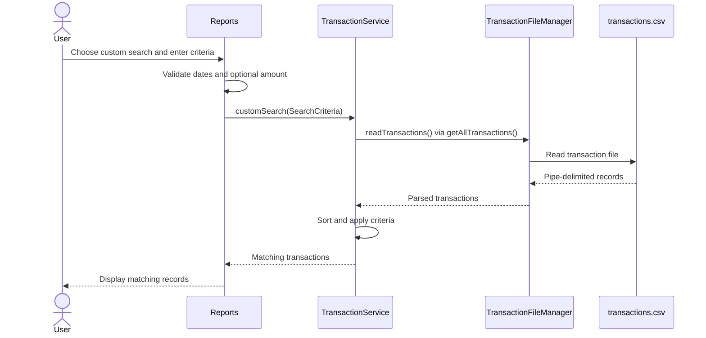

# Accounting Ledger Application

A Java command-line ledger for recording deposits and payments, and reviewing the records through chronological views and reports. The terminal UI is styled as a shipboard archive, while the underlying application uses a small set of classes for input, transaction operations, persistence, search, and display.

## Features

- Record deposits as positive amounts and payments as negative amounts.
- Store transactions locally in `transactions.csv` and load them for ledger views and reports.
- View all transactions, deposits only, or payments only.
- Sort transaction listings newest first by date and time.
- Generate month-to-date, previous-month, year-to-date, and previous-year reports.
- Search by vendor or use custom criteria for date range, description, vendor, and amount.
- Validate entered amounts and custom-search dates; skip malformed records when reading the data file.

## Technologies

- **Java 17** — application language and runtime.
- **Apache Maven** — project build configuration and lifecycle.
- **Java standard library** — console input/output, file access, and date/time handling.
- **Pipe-delimited local text file** — persistent transaction data in `transactions.csv` (despite the `.csv` extension, fields are separated with `|`).

## Architecture

This is a single-process console application with no web server or database. `Main` coordinates the interactive menu. The ledger and reports delegate transaction retrieval to `TransactionService`; the service uses `TransactionFileManager` for storage and returns `Transaction` objects. `Reports` renders the result sets to the terminal.



### Class responsibilities and relationships



`Main.read` is the shared console `Scanner` used by the menus and report prompts. `TerminalUI` is a small formatting utility; the application does not use a graphical interface.

### Example flow: adding a transaction



### Example flow: custom report search



## Project structure

```text
.
├── pom.xml
├── transactions.csv
└── src
    └── main
        └── java
            └── com
                └── pluralsight
                    ├── Main.java
                    ├── StartupScreen.java
                    ├── TerminalUI.java
                    ├── Ledger.java
                    ├── Reports.java
                    ├── SearchCriteria.java
                    ├── Transaction.java
                    ├── TransactionService.java
                    └── TransactionFileManager.java
```

- `Main.java` — application entry point and deposit/payment prompts.
- `StartupScreen.java`, `TerminalUI.java` — startup/shutdown presentation and reusable terminal separators.
- `Ledger.java`, `Reports.java` — archive menus, report selection, searches, and transaction table output.
- `Transaction.java`, `SearchCriteria.java` — transaction model and custom search criteria.
- `TransactionService.java` — loading, sorting, filtering, and searching transactions.
- `TransactionFileManager.java` — appends and reads records in the working-directory data file.
- `transactions.csv` — sample/persistent data file expected in the process working directory.

## Usage

Start the program from the repository root:

At the home menu, enter:

- `D` to record a deposit.
- `P` to record a payment.
- `L` to open the transaction archive.
- `X` to shut down the application.

For example, after selecting `D`, provide a description, vendor/source, and a positive amount when prompted. Selecting `P` uses the same prompts, but the application stores the amount as negative. Amount input must be numeric and greater than zero; the application applies the transaction sign itself.

In the archive, choose `A` for all transactions, `D` for deposits, `P` for payments, or `R` for reports. Reports provide month/year date ranges, vendor search, and custom search. Custom-search dates use `YYYY-MM-DD`; criteria may be left blank, and a provided amount matches the absolute transaction amount.

Transactions are appended to `transactions.csv` in this format:

```text
YYYY-MM-DD|HH:mm:ss|description|vendor|amount
```

For example:

```text
2026-11-06|09:15:00|Archive organization bonus|Jedi Academy Arts|67.00
```

The file manager skips the first line as a header and reports malformed records while continuing to read valid ones. Since the storage path is relative, launching from another directory may cause the application to read or create a different `transactions.csv` in that directory.

## Testing

For a basic manual check, run the program from the project root, add a deposit and a payment, then open the archive and confirm both entries appear with their expected signs. The records will be appended to `transactions.csv`; make a backup first if you need to preserve the sample data unchanged.

## Potential future enhancements

These are suggestions, not existing capabilities:

- Add automated unit tests for sorting, date boundaries, search behavior, and file parsing.
- Use a CSV library or escaping rules so descriptions and vendor names can safely contain delimiter characters.
- Validate amounts with `BigDecimal` for currency precision.
- Make the data-file path configurable and provide safer handling when the file is absent.
